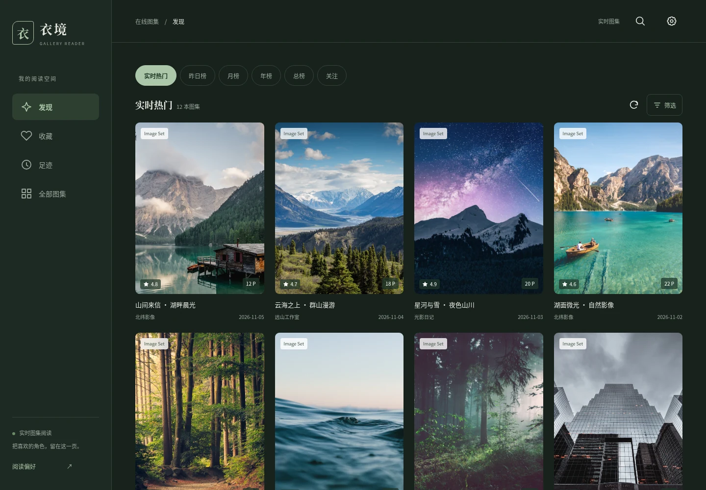
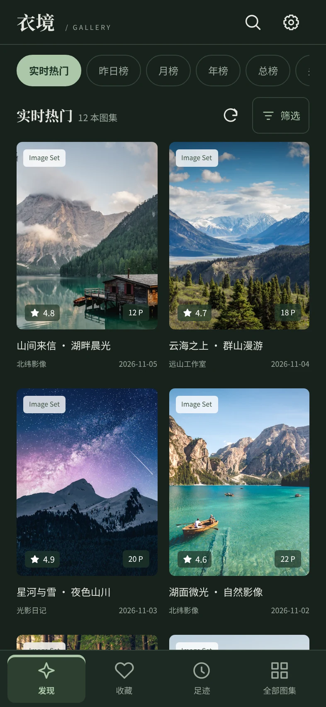
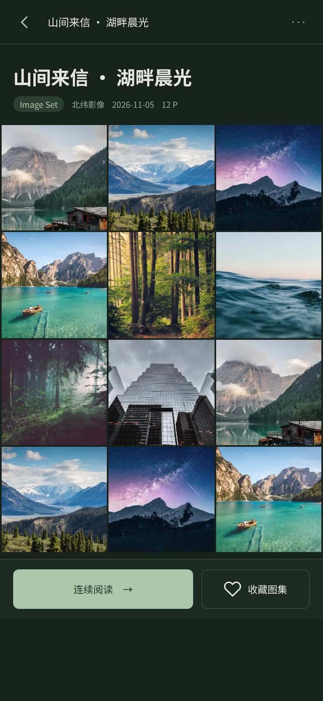
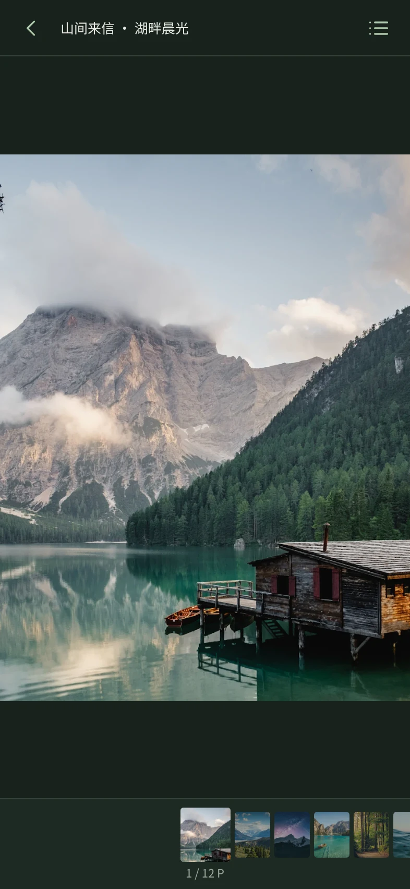
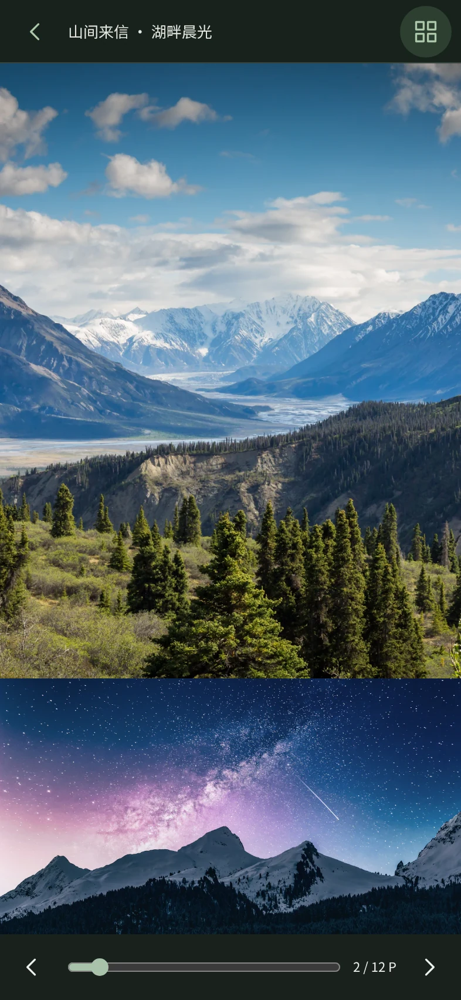

<p align="center">
  
</p>

<h1 align="center">Gallery Reader</h1>

<p align="center">适合手机、平板和桌面浏览器的图集阅读器，提供简洁的浏览、搜索与阅读体验。</p>

<p align="center"><a href="https://gallery.polishwb1020.com">在线体验</a></p>

## 主要功能

- 热门发现、分类筛选、高级搜索和以图搜图。
- 缩略图预览、照片模式、沉浸查看、手势缩放和上下连续阅读。
- 收藏管理、浏览足迹、搜索历史和阅读进度保存。
- 图片预载、本地缓存、深浅色主题和 PWA 支持。
- 导出图片下载清单，配合独立下载器批量保存。

## 界面预览

桌面端支持侧栏导航与多列浏览，移动端提供底部导航和手势阅读；深浅色主题可在设置中切换。



<table>
  <tr>
    <th>移动浏览</th>
    <th>图册详情</th>
  </tr>
  <tr>
    <td></td>
    <td></td>
  </tr>
  <tr>
    <th>照片模式</th>
    <th>连续阅读</th>
  </tr>
  <tr>
    <td></td>
    <td></td>
  </tr>
</table>

截图使用演示数据，图片来源见[截图说明](docs/screenshots/README.md)。

## 本地运行

需要 Node.js 22 或更新版本。

```sh
npm install
npm run dev
```

浏览器打开 <http://localhost:3000>。

```sh
npm test       # 运行测试
npm run build  # 构建应用
```

部署到 Vercel 时，构建命令为 `npm run build`，输出目录为 `dist/`。项目包含服务端接口，需要支持 Node.js 或 Vercel Functions 的运行环境。

## iOS 下载器

仓库内包含独立的通用图片下载器，支持导入链接清单、保存到文件目录或相册，以及更新失效链接后继续下载。

构建与安装方法见 [ImageBatch 使用说明](apps/ImageBatch/README.md)。
